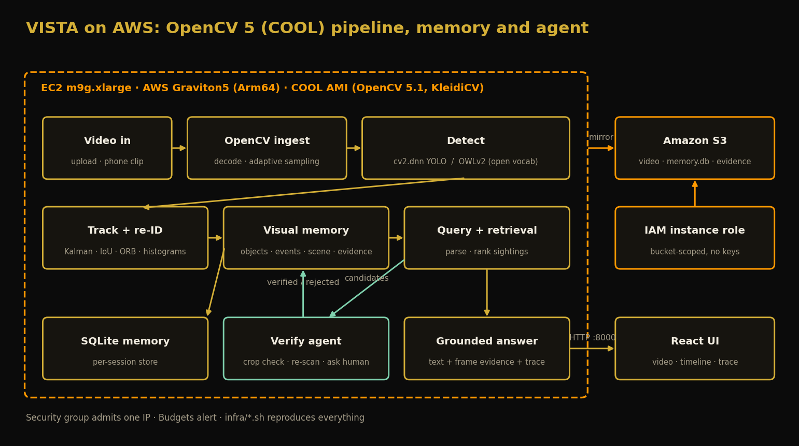
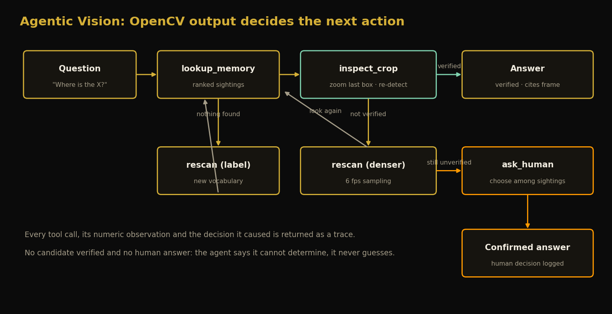

# VISTA: technical report

_Visual Intelligence & Spatial Temporal Archive. OpenCV AI Competition 2026 powered by AWS. Generated by `scripts/build_eval_docs.py`; every figure comes from `docs/eval/*.json`._

## 1. Summary

VISTA turns video into a persistent, queryable memory of objects and events and answers questions such as "where did I leave the charger?" with the frame that proves it. An OpenCV 5 pipeline decodes and samples video, detects, tracks and re-identifies objects, and stores them in a visual memory. A verify agent then checks the answer on a zoomed crop and falls back to a re-scan or to the human instead of guessing. The deployed system runs on an AWS Graviton5 instance (COOL OpenCV 5.1) with Amazon S3 for durable storage.

Headline results (details in `docs/EVALUATION.md` and `docs/BENCHMARK.md`):

- On Graviton, the full pipeline runs at 20.1 fps (COOL) / 19.5 fps (stock pip OpenCV) against 14.6 fps on an x86 instance of similar price: about 1.33x faster and 31% cheaper per processed frame. COOL itself is within noise of stock OpenCV on the same Arm hardware (+2.8%), because the pip arm64 wheel already includes KleidiCV.
- "Where is the X?" on 20 real phone videos: the lead answer is right 75% of the time with a closed-set YOLOv8n (from 55% before the ranking and tracker fix) and 90% with open-vocabulary OWLv2 (laptop runs). Re-run on the deployed COOL instance, YOLOv8n's lead answer was 60%; the cause of the gap is not isolated.
- Tracking on MOT17 is modest: MOTA 0.15-0.53, IDF1 0.22-0.54; precision 0.81-0.90 but recall only 0.23-0.68 (lowest on the crowded 1080p scenes).
- On two hand-checked clips: 2/5 with YOLOv8n and 4/5 with OWLv2 plus on-demand re-scan.

## 2. Problem and users

People lose track of small objects (keys, chargers, coins) and of what happened around them. Searching hours of video by eye does not scale, and a generic video-QA model answers fluently without evidence. VISTA targets anyone with phone or camera footage who needs a located, auditable answer: households, small workshops, inventory and lost-and-found, and accessibility use ("where did I put my glasses?"). The design rule is that an answer must point at a frame, and that "I cannot determine" is a valid answer.

## 3. System design

1. **Ingest** (OpenCV): decode, adaptive sampling (about 2 fps, early samples on motion or change).
2. **Detect**: `cv2.dnn` YOLO (closed set, runs on the Arm CPU with COOL), or OWLv2 for open-vocabulary prompts (any noun the user asks about is added to the prompt list and the video re-scanned on demand).
3. **Track and re-identify**: Kalman prediction, IoU and appearance association, ORB and histogram re-identification, occlusion handling.
4. **Visual memory**: objects, events (appeared, moved, picked up, placed), scene state and relationships, evidence frames, persisted in SQLite and mirrored to S3.
5. **Query**: natural-language parsing, temporal and relational retrieval, evidence-grounded answers that separate observed facts from inferences.
6. **Verify agent** (section 6) and a React UI with video seek, timeline, evidence and the agent trace.

## 4. OpenCV 5 implementation

| OpenCV capability | Where it is used |
|---|---|
| `VideoCapture` / FFmpeg decode | ingestion, source-frame lookup for evidence and crop checks |
| `cv2.dnn` (ONNX) | YOLO detection on the Arm CPU; also `NMSBoxes` for the open-vocabulary detector |
| `calcOpticalFlowFarneback` | camera-motion estimate; adaptive sampling and scene-change gating |
| `createBackgroundSubtractorMOG2` | foreground score for sampling and the optional saliency fallback |
| `ORB` + descriptor matching, HSV histograms | appearance profile for re-identification and similar-object search |
| `KalmanFilter` | motion model for tracking and occlusion prediction |
| `resize` (area/linear/cubic), `copyMakeBorder`, `cvtColor`, `GaussianBlur`, `Canny` | preprocessing; the agent's square zoom crop |

The deployed instance runs OpenCV 5.1.0-dev from the COOL AMI (`cv2.__file__` under `/opt/cool`, KleidiCV 0.7.0); local development uses the pip OpenCV 5.0.0 wheel. Pinned versions are in `uv.lock`.

## 5. AWS deployment and COOL

EC2 `m9g.xlarge` (Graviton5) launched from the Cloud Optimized OpenCV AMI runs the API and UI as a systemd service; Amazon S3 keeps the source video, memory database and evidence frames; an IAM instance role scopes access to one bucket with no keys on the box; a security group admits one IP. Everything is reproducible with `infra/*.sh` (`docs/AWS_DEPLOYMENT.md`), including the evidence that COOL runs the workload (library paths, build string, process maps).

The COOL comparison (`docs/BENCHMARK.md`) runs one fixed OpenCV workload on three instances. Graviton beats x86 on throughput and price, but COOL does not beat stock pip OpenCV on this workload (20.06 vs 19.51 fps end to end); it is faster on ORB features and slower on decode and `cv2.dnn`. We report that as measured. Caveats: COOL is 5.1.0-dev versus pip 5.0.0, one clip, one instance per setup.

## 6. Agentic Vision: the verify loop

A memory lookup can return stray or low-confidence tracks. The agent treats the lookup as a hypothesis and tests it with OpenCV, and the result decides the next action:

- **lookup_memory**: ranked sightings (most recent, then best supported). Nothing found: **rescan** with the new label.
- **inspect_crop**: cut a square window around the claimed box from the source frame, upscale it (cubic), and re-run the detector. Verified: answer with that confidence. Rejected: try the next candidate.
- Nothing verifies: **rescan at denser sampling** (6 fps) and look again.
- Still nothing: **ask the human** to choose among the top sightings; otherwise report "cannot determine".

Human control and observability: every tool call, numeric observation and decision is returned as a trace and shown in the UI; `POST /api/confirm` records the human decision; the agent never invents a location. Evaluation on the same Objectron task (YOLOv8n):

| | Dev clips (seed 0) | Held-out clips (seed 1) |
|---|---:|---:|
| Baseline lead answer (no checking) | 75% | 80% |
| Auto-verified answers | 12 / 20 | 17 / 20 |
| Precision of auto-verified answers | 100% | 88% |
| Deferred to the human | 7 | 1 |
| Correct without the human | 60% | 75% |
| Correct when the human picks among the options shown | 90% | 80% |
| Mean tool calls per question | 5.0 | 2.45 |

The loop is deterministic and uses no language model. Its limit is that it re-uses the same detector, so it removes unstable detections but cannot catch a consistent error (a printed photo of a face is still a "person"); the human step exists for that.

## 7. Evaluation

Three public or hand-checked evaluations with failure cases (`docs/EVALUATION.md`): 20 Objectron phone videos for "where is the X?", four MOT17 sequences for tracking and memory (own CLEAR-MOT/IDF1 implementation, unit-tested), and five hand-checked questions on two clips. Failure cases include a flat book missed on a shop shelf, a flashlight package reported as a notebook, crowded 1080p pedestrians missed by a nano detector, and a printed photo reported as a person.

## 8. Limitations and next steps

- Small samples (20 Objectron clips; four MOT17 sequences; five hand-checked questions). Differences of one clip move a class by 25 points.
- The closed-set detector is weak on flat or unusual views; the open-vocabulary detector is slower and produces persistent false-positive tracks at a low confidence threshold (132 tracks on one clip, one correct).
- The MOT17 detector is nano-sized; a larger model or tiled inference would help crowded scenes.
- Single session, no API authentication (relies on the security group), no multi-user store.
- Next: detector-independent verification (e.g. a second model), confidence calibration, multi-clip memory.

## 9. Responsible use

VISTA stores video, frames and per-person tracks. Process footage only with the consent of the people filmed; purge a session by deleting its S3 prefix; treat person counts and identities as suggestions that need human review (a photograph of a person is reported as a person). The agent asks rather than guesses when it cannot verify.

## 10. Team and reproducibility

Team: I am Abhijna DS, an undergraduate at PES University, Bengaluru. This is a solo entry. Contact: abhijnads16@gmail.com.

Reproduce: `docs/AWS_DEPLOYMENT.md` (infrastructure), `docs/BENCHMARK.md` (COOL benchmark), `docs/EVALUATION.md` (evaluations), `README.md` (local setup, tests: `uv run pytest`). Dependencies are pinned in `uv.lock`.
